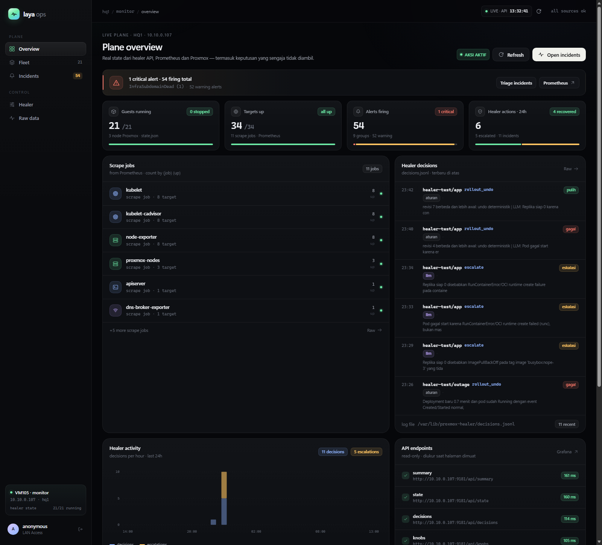

# Laya Ops

Read-only control-plane console for the **VM105 monitoring plane + self-healer**
(Prometheus · Alertmanager · Grafana · `proxmox-healer` · k8s heal module).

This is the proper backend + frontend version of the earlier static design
prototype (`../laya-ops-design/`): the browser talks only to a FastAPI service on
the same origin; the service talks to the healer API, Prometheus and the service
health endpoints. **There is no write path and no open proxy.**



## Architecture

```
 browser (React SPA)
        │  same-origin /api/*  (session cookie, CSP, no CORS)
        ▼
 FastAPI  ── httpx (read-only, server-side allow-list) ──► healer 127.0.0.1:9181
   │                                                          /api/summary, /api/state,
   │                                                          /api/decisions, /api/knobs,
   │                                                          /api/pending, /metrics
   │                                                          Prometheus 127.0.0.1:9090
   │                                                          /api/v1/query  (ALERTS, jobs)
   │                                                          Alertmanager :9093 /-/ready,
   │                                                          /api/v2/alerts (push alerts)
   │                                                          Grafana :3000 /api/health
   │                                                          classifier :8090/healthz  (opsional)
   │                                                          sre-healer :8080/healthz, /decisions
   └── serves built SPA  (index.html + /assets + /icons.js)
```

- **Aggregation & normalisation live in the backend** (`backend/app/aggregate.py`):
  summary mapping, guest/decision joins, alert grouping + ageing, scrape jobs,
  healer metrics, runbooks. The frontend only renders typed payloads.
- **Caching**: 4 s TTL for expensive aggregates (`CACHE_TTL`).
- **Auth**: `off` (LAN only), `password` (env secret) or `oidc` (Keycloak).
  Session cookie is HttpOnly/SameSite=Lax; login attempts are rate-limited.
- **Security**: CSP `default-src 'self'`, no CORS, `TrustedHostMiddleware`
  (`ALLOWED_HOSTS`), no upstream URL parameter, only whitelisted raw sources,
  and no action endpoints at all.

## Repository layout

```
laya-ops/
├── backend/
│   ├── app/
│   │   ├── main.py        FastAPI factory, SPA hosting, health, /metrics
│   │   ├── config.py      pydantic-settings (env / .env)
│   │   ├── auth.py        password + Keycloak OIDC + session
│   │   ├── upstream.py    httpx probes, short errors, timing
│   │   ├── aggregate.py   normalisation, alert grouping, runbooks
│   │   ├── routes.py      /api/overview, /api/guests, /api/alerts, ...
│   │   ├── cache.py       async TTL cache
│   │   ├── security.py    hardening headers
│   │   └── schemas.py     pydantic response models
│   ├── tests/             pytest + respx (21 tests, mocked upstreams)
│   ├── requirements.txt
│   └── requirements-dev.txt
├── frontend/
│   ├── src/
│   │   ├── App.tsx, main.tsx
│   │   ├── components/    AppShell, ui kit, charts, endpoint list
│   │   ├── pages/         Login, Overview, Fleet, Incidents, Healer, Raw
│   │   ├── data/          api client, typed models, formatting (+ tests)
│   │   ├── hooks/         useApi polling hook
│   │   ├── state/         auth, refresh, toast providers
│   │   └── styles/        design system (ported from the prototype)
│   └── package.json       React 19 + TypeScript + Vite
├── Dockerfile             multi-stage: node build → python runtime
├── docker-compose.yml     host-network service on :9190
└── .env.example
```

## Quick start (development)

Requirements: Python 3.12+, Node 24+, pnpm.

```bash
# backend
cd backend
python -m venv .venv
.venv/Scripts/pip install -r requirements-dev.txt      # Linux/macOS: .venv/bin/pip
.venv/Scripts/python -m uvicorn app.main:app --reload --port 8000

# frontend (another terminal)
cd frontend
pnpm install
pnpm dev        # http://127.0.0.1:5173, proxies /api to :8000
```

Copy `.env.example` to `.env` and set the `*_BASE` values for where the backend
runs: `127.0.0.1` on VM105 itself, or `10.10.0.107:9181/9090/9093/3000` from
another machine on the LAN.

```bash
cp .env.example .env    # set AUTH_MODE, APP_PASSWORD, SESSION_SECRET, ...
cd backend && python -m uvicorn app.main:app --host 0.0.0.0 --port 9190
```

`AUTH_MODE=off` is the LAN-only mode (the app still binds to the given address —
do not expose it publicly; put it behind a tunnel/reverse proxy instead).

## API

All endpoints under `/api/*` require a session unless `AUTH_MODE=off`.
Responses are pydantic models; `/api/docs` exposes OpenAPI (FastAPI).

| endpoint | isi |
|---|---|
| `GET /api/overview` | agregat halaman overview: summary, guests, alerts, jobs, decisions, endpoint probes, metrics, links |
| `GET /api/status` | ringan untuk shell/nav: summary + alert counts + jobs down + healer up |
| `GET /api/guests` | guest state + last decision per vmid |
| `GET /api/alerts` | alert group Prometheus + counts + oldest + runbook + push alert healer dari Alertmanager |
| `GET /api/knobs` | `/api/knobs` healer + metrics berlabel + last decision + pending + classifier/engine (opsional) |
| `GET /api/pending` | antrean persetujuan manusia dari healer (read-only, tanpa approve/reject) |
| `GET /api/decisions?limit=` | decision log terbaru (termasuk jenis/tingkat/izin/state) |
| `GET /api/raw?sources=` | payload mentah whitelisted (`summary,state,knobs,decisions,metrics,pending,alerts,push_alerts,jobs`) |
| `GET /api/auth/config` | mode auth + user |
| `POST /api/auth/login` | login password (rate-limited) |
| `GET /api/auth/oidc/login`, `/api/auth/oidc/callback` | Keycloak OIDC flow |
| `POST /api/auth/logout` | hapus session |
| `GET /api/healthz`, `/api/readyz` | liveness / readiness (readyz memeriksa healer) |
| `GET /metrics` | metrik Prometheus proses app |

## Tests

```bash
cd backend && .venv/Scripts/python -m pytest -q      # 21 passed
cd frontend && pnpm test && pnpm build               # vitest + tsc + vite
```

The backend tests use `respx` and fixtures captured from the real VM105
(`summary`, `state`, `decisions`, PromQL payloads) — no network needed.

## Deploy on VM105 (docker compose)

The monitoring stack already runs on VM105; add this as a separate compose
project so nothing existing is touched:

```bash
# from the laptop
scp -r laya-ops root@10.10.0.107:/opt/laya-ops
ssh root@10.10.0.107
cd /opt/laya-ops
cp .env.example .env
#   AUTH_MODE=password, APP_PASSWORD=..., SESSION_SECRET=$(openssl rand -hex 32)
#   ALLOWED_HOSTS=laya.hq1.lan,10.10.0.107
docker compose up -d --build
curl -s localhost:9190/api/healthz
```

- Host networking lets the backend reach `127.0.0.1:9181/9090/9093/3000`.
- The app listens on **:9190**, so the old `:9181/ui` static mock can stay until
  the new console is verified. Switch DNS/CF Access to `:9190` afterwards.
- For a public hostname: terminate TLS in front of `:9190` (Caddy/nginx/CF Access),
  set `COOKIE_SECURE=true`, and keep `ALLOWED_HOSTS` exact.
- Do **not** expose `:9190` on the public internet without auth; the default
  `AUTH_MODE=password` exists for a reason.

## Read-only guarantees

- No endpoint proxies arbitrary URLs: every upstream call is built from
  server-side settings, so the app cannot be used as an SSRF/open proxy.
- No `start`/`reset`/`rollout_undo`/`ack`/`silence`/`approve`/`reject` endpoints.
  The healer loop remains the only actor; the UI only visualises `decisions.jsonl`,
  the approval queue (`/api/pending`) and Prometheus.
- Human approval stays on the VM105 CLI (`healer.py --pending/--approve`); Ops
  shows the queue and copyable commands, never a write path.
- Grafana is linked, not queried: its admin API needs credentials the browser
  must never hold.
- Prometheus alert annotations are not exposed by the PromQL query proxy; the UI
  says so and links to Prometheus. Namespaced healer push alerts (PveHealer*,
  Healer*) are read from Alertmanager `/api/v2/alerts`, including annotations.

## Roadmap (needed before any write action exists)

1. Replace session-password with Keycloak OIDC in production (already wired,
   needs a client in the `school` realm and `OIDC_*` env).
2. If actions are ever wanted: separate signed/audited action API with RBAC,
   explicit confirmation, and `decisions.jsonl` entries — never a generic proxy.
3. Tail pod logs on demand through the k8s API (read-only, namespace allow-list).
4. WebSocket/SSE streaming instead of 15 s polling.
5. Grafana proxy with a dedicated read-only service account if panel embedding
   is needed.
